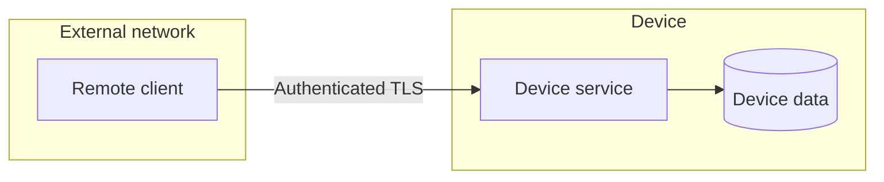

# BOUNDARY-M3-001 — Device network trust boundary

## Boundary



## Properties

| Field | Type | Multiplicity | Constraints |
|---|---|---|---|
| boundary_id | UUID | 1..1 | identity |
| trust_level | String | 1..1 | minLength: 1 |
| ingress_protocol | String | 1..1 | minLength: 1 |

## Invariants

### ExternalTrafficIsAuthenticated

```ocl
context DeviceNetworkTrustBoundary
inv ExternalTrafficIsAuthenticated:
  self.ingress_protocol <> 'plaintext'
```
